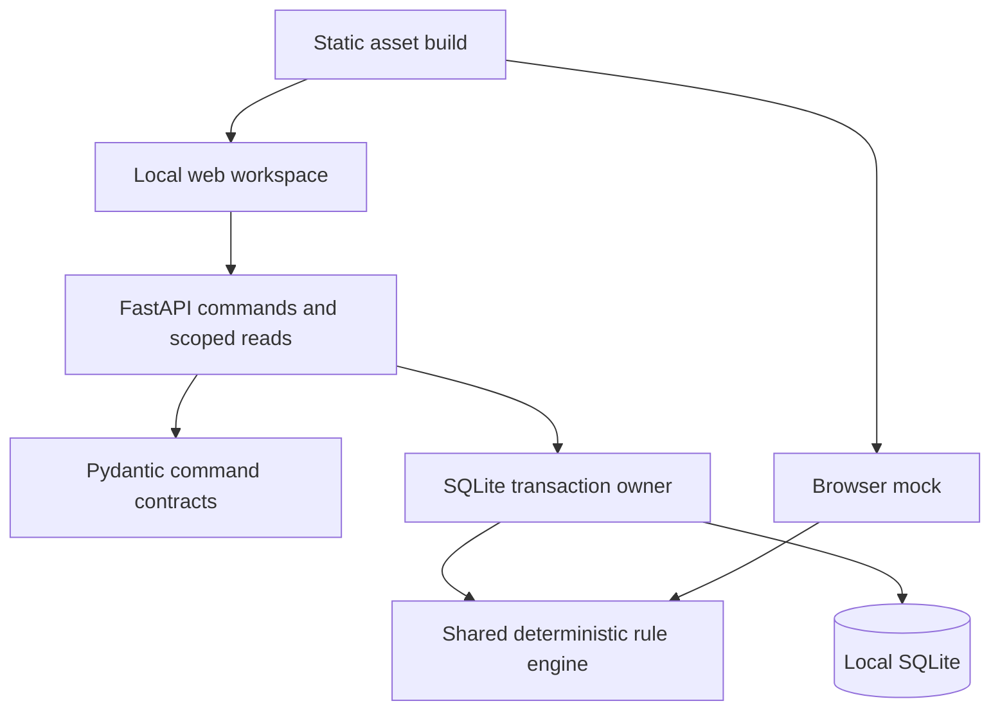
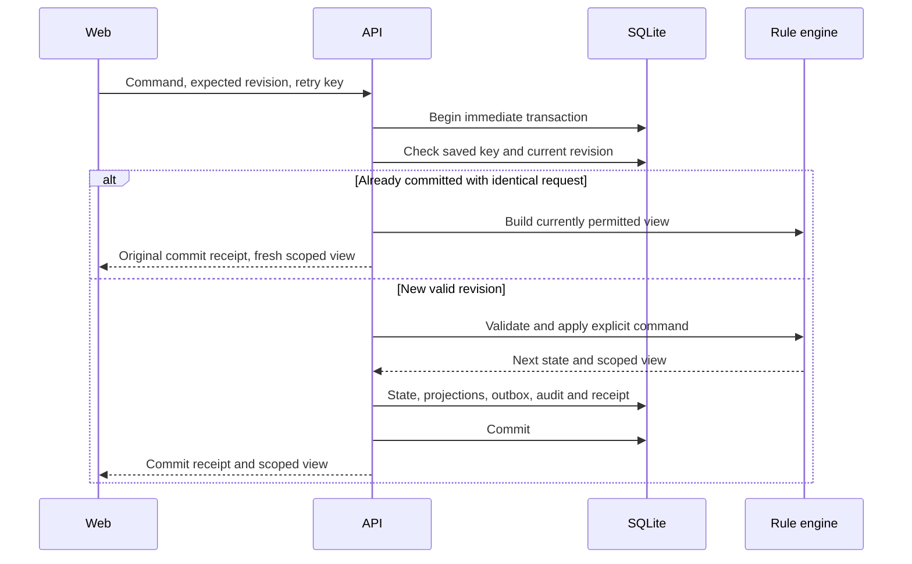

# ADR-007 — One repository, one local writer, one rule implementation

22 October 2026. Implemented prototype decision, replacing no clinical requirement.

The 20 October architecture recommended Nuxt/Vue/TypeScript, FastAPI/Pydantic, SQLite/SQLAlchemy/Alembic and a staged local-model evaluation. It explicitly left those choices conditional. v0.6 subsequently established a working JavaScript rule engine with 74 tests. This change preserves that evidence while adding a durable local service.

| Concern | Implemented in v0.7 | Deferred decision / reason |
| --- | --- | --- |
| Web | Static HTML/CSS/ES modules; browser mock and local API workspace | Nuxt remains a migration candidate; changing framework does not prove the care workflow |
| API | FastAPI and strict Pydantic discriminated commands | Real identity provider and deployment policy need a separate design |
| Domain | Existing shared JavaScript engine, invoked through a bounded Node process | Transitional adapter, not a throughput architecture; Python port needs fixture parity before replacement |
| Database | Python sqlite3, checked SQL migration, explicit transactions | SQLAlchemy/Alembic deferred until the durable slice and broader schema are reconciled |
| Automation | Persisted outbox and deterministic virtual-clock replay | No unattended real-device or clinical action executor |
| AI | Deterministic explanations only | Model inference/fine-tuning remains gated by source rights, clinical review and actual 18 GB Mac measurements |
| Research | Separate checked OSD-569 importer and source catalog | No public research person is relabeled as simulated crew |

## Dependency ownership

`web/` never opens a database. `api/` owns migration, transactions and role-specific response projection. `packages/domain/` owns comparison, assignment, review, correction and handoff rules. `packages/contracts/openapi.json` is generated from Pydantic and tested for drift. Only `Store.command()` writes authoritative state. There is no endpoint to replace arbitrary state, change grants by supplying an actor object, or import browser localStorage into the database.

The process adapter receives JSON on stdin, uses a fixed executable path and argument list, has a 5-second timeout and accepts a fixed operation/command set. It does not run supplied shell commands. A command holds SQLite's single writer transaction during rule evaluation. That is acceptable for this small episode and is a documented performance limit. No high-rate waveform ingestion should use this path. The adapter's 4 MB input bound and complete aggregate read mean the current implementation is deliberately bounded; no unlimited historical growth claim is made.

## Durable operation

A retry key is scoped to the fictional actor and bound to the complete request hash, including the expected revision. A changed payload with the same key is rejected. A different command against an old revision is rejected. The client retains the pending key across a reload when the outcome is unconfirmed. Retried responses reapply current read scope rather than returning a cached medical view after a grant is revoked.

## Deployment boundary

`npm run dev` serves the local API workspace and static assets on the same loopback origin. The default root is the API-connected workspace. `/index.html` opens the earlier browser-local mock and research lab, which use separate storage. These are explicitly labeled modes; they do not silently synchronize.

The existing private Site serves `dist/index.html` as a static demonstration. It cannot run Python/SQLite. The repository contains the local service, but publishing the static Site does not deploy that service. No server, model, container platform, cloud database or paid service is provisioned.

## Decision gates

1. Run the local flow on the actual M3 Pro, 18 GB machine and check browser behavior, latency, memory and interrupted requests.
2. Reconcile the wider 42-table design against this implemented slice before adding more domains.
3. Replace demonstration identity with reviewed authentication, scoped authorization, encrypted storage and transport before using any non-fictional medical record.
4. Qualify device binding, source rights, methods, units, baseline selection and clinical workflow separately.
5. Profile aggregate growth before selecting a Python port, persistent engine worker or domain decomposition. Add paging and projections for actual volume; do not move waveform blobs into this aggregate.

## Engineering references

- [FastAPI testing](https://fastapi.tiangolo.com/tutorial/testing/), [lifespan tests](https://fastapi.tiangolo.com/advanced/testing-events/).
- [SQLite transactions](https://www.sqlite.org/lang_transaction.html), [foreign keys](https://www.sqlite.org/foreignkeys.html), [WAL](https://www.sqlite.org/wal.html), [online backup](https://www.sqlite.org/backup.html).
- [GitHub checkout](https://github.com/actions/checkout), [setup-node](https://github.com/actions/setup-node), [setup-python](https://github.com/actions/setup-python). CI definitions were checked against the official repositories; a local test run is not a successful hosted CI run.
