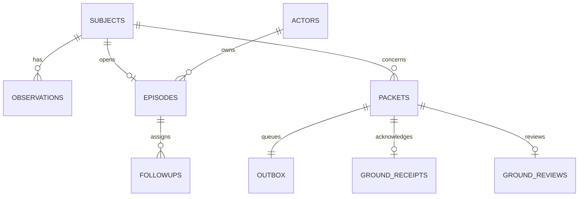

# Database and data ownership

The executable migration is `api/migrations/001_local_episode.sql`. This is the implemented assessment-day slice, not the complete earlier 42-table design. Values remain decimal text; no floating-point rewrite changes the comparison. Original method, time basis, units, provenance and correction links remain in each immutable observation document.

| Table | Purpose | Mutability |
| --- | --- | --- |
| schema_migrations | Applied migration filename and SHA-256 | Append; changed applied SQL stops startup |
| subjects | Fictional subject namespace | Fixed seeded simulation |
| actors | Fictional people and roles | Fixed seeded simulation |
| source_references | NASA reference and applicability caveat | Selected reference, not clinical qualification |
| workspaces | Authoritative aggregate and optimistic revision | Updated once per committed command |
| observations | Measurement revisions with subject, unit, method, raw JSON | Insert only; SQL blocks updates/deletes |
| episodes | Current review state, owner and assignment history | Projected atomically from the aggregate |
| followups | Responsible owner, trigger and outcome | Explicit transitions, preserved history in document |
| packet_drafts | Unreleased exact previews and staleness | Invalidated by changed evidence or workflow context |
| packets | Approved canonical UTF-8 payload and hash | Insert only; SQL blocks updates/deletes |
| outbox | Delivery state for already-approved packets | Durable transport projection |
| ground_receipts | Exact packet acknowledgement | First receipt retained |
| ground_reviews | Separate review of a received snapshot | First review retained |
| audit_events | Domain transition events | Insert only; SQL blocks updates/deletes |
| command_receipts | Actor/key/request hash and committed revision | Insert only by command handler |

SQLite foreign keys are enabled per connection. WAL and `synchronous=FULL` are used, with a bounded busy timeout. `BEGIN IMMEDIATE` serializes writes before reading the current aggregate revision. An exception rolls back the aggregate, indexes/projections, event rows, queue and retry receipt together. Database projections are useful for inspection and future indexed reads; the current API reads the bounded aggregate through the shared rule engine. They must not be edited independently.

The database defaults to `.runtime/chnai.sqlite3` and is excluded from git. A new database is seeded once from `packages/domain/src/service.mjs`. There is no destructive reset endpoint. To run a fresh isolated demonstration, use a new `CHNAI_DB` filename. Existing browser state is not automatically imported. The selected scenario starts after a fictional completed assessment has arrived, with the primary reviewer occupied and the backup available.

Use `scripts/backup.py` for SQLite online backup. Do not copy just a live `.sqlite3` file while its WAL may contain committed changes. Restore by selecting the checked backup as `CHNAI_DB` after stopping the old process. Backup, foreign-key integrity and reopening in a separate Python process are tested; hardware power-loss and disk corruption are not qualified.

The local files are not encrypted. Demonstration role selectors are not identity authentication. This database must contain fictional operational data only. Research files remain outside these operational tables. Real medical data needs a separately reviewed storage, identity, retention, consent and security design.
