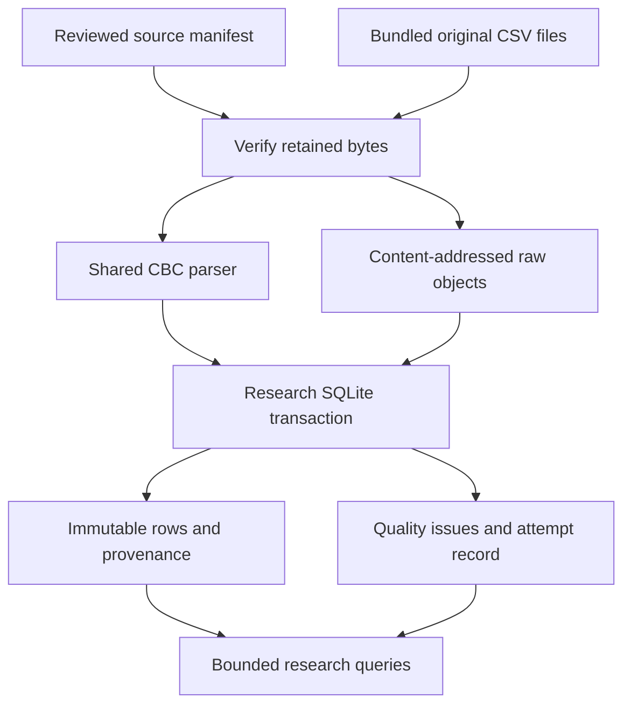
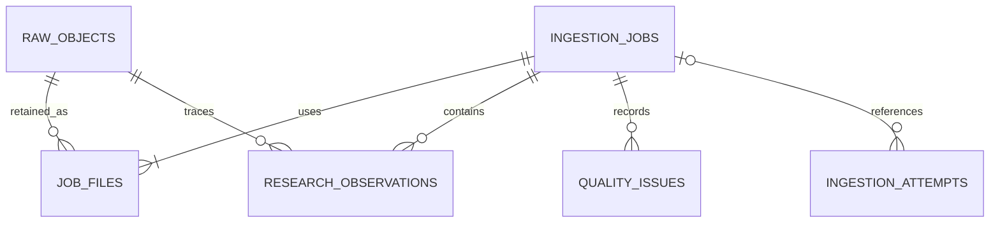

# Research ingestion — v0.8

The earlier research importer could inspect the bundled OSD-569 files in browser memory. This slice adds reproducible import jobs, raw-object retention, immutable provenance and bounded API queries. It supports exactly one reviewed, retained CBC snapshot. It is not a live NASA feed or a general arbitrary-file upload service.

## Ownership and data flow

The operational crew database is not part of this flow. Its assessment, review, packet and outbox remain in their existing store. Research uses a separate SQLite file and a separate raw-object directory, with no subject join or schema attachment to crew records. Startup opens the research store lazily so a research initialization failure does not prevent loading the crew workspace. Both still share one application process; resource exhaustion and process failure are not isolated services.

| Component | Owner and contract |
| --- | --- |
| `data/catalog/osd569-ingestion.json` | Fixed dataset, CHNAI snapshot label, rights/use scope, original URLs, expected byte sizes and SHA-256 values |
| `web/public/data/` | The existing exact retained public CSV assets; no network fetch occurs during import |
| `packages/domain/src/cbc.mjs` | One pure CBC inspection implementation used by browser and API; source units and relative times are retained |
| `scripts/research-bridge.mjs` | Bounded Node parser process; two source texts through stdin, fixed module and timeout, no caller paths or code |
| `api/src/chnai_api/research.py` | Source verification, object retention, pipeline fingerprints, transactions, attempt history and indexed reads |
| `api/research_migrations/` | Separate research schema and checked migration hashes |
| `web/src/research-registry.mjs` | Engineering inspection of import status, source rows, issues and downloadable manifest |

The default crew path `.runtime/chnai.sqlite3` maps to `.runtime/chnai.research/research.sqlite3` and `.runtime/chnai.research/objects/<sha256>`. A custom `CHNAI_DB` maps to the same parent and `<database-stem>.research/`. Equal research and crew database paths are rejected. Paths remain ignored by Git.

## Schema

| Research table | Meaning | Retention behavior |
| --- | --- | --- |
| research_migrations | Applied SQL filenames and digests | Changed applied migration stops research initialization |
| raw_objects | Digest, length, object key and retained timestamp | Application registry is insert-only |
| ingestion_jobs | Dataset, namespace, snapshot, parser version, manifest and summary | Immutable accepted import |
| job_files | Submitted/transformed file links for an accepted import | Immutable; links raw objects to jobs |
| research_observations | Source record index, raw value/unit/time, public research ID, analyte and original provenance | Immutable; separate research namespace |
| quality_issues | Unit-label conflicts and structurally quarantined rows | Immutable; conflicts preserve both original file/record locations |
| ingestion_attempts | Accepted, replayed or rejected attempts with observed digests and reason | Immutable; attempts are not extra datasets or people |

Observation IDs are unique within a job; the same source row in another parser/runtime snapshot is not a new person. Counts are explicitly scoped to an import. The 28 wide rows overlap the submitted representation; the application does not add them as 28 independent specimens.

## Fingerprint and failure behavior

The import ID is `RI-` followed by the SHA-256 of a canonical manifest. The manifest includes source URLs, expected exact bytes, project snapshot label, rights/use notes, parser version, hashes of the CBC module/domain hash helper/bridge/Python ingestion implementation, and Node/Python runtime versions. It is an implementation fingerprint, not a NASA digital signature or an official dataset-version identifier.

An identical verified snapshot and pipeline reuses its existing job and records a replayed attempt. Changed source or parser/runtime metadata produces a different fingerprint; changing the allowlist still requires a reviewed code/catalog update. Import requests cannot provide a URL, filesystem path, namespace or arbitrary upload. Repeated concurrent imports serialize at the SQLite write transaction and produce one accepted job.

Raw bytes are read with a declared-size bound and checked before parsing. Original BOM and line endings are retained. Objects are written through a temporary file and an exclusive filesystem link; existing corrupt objects are rejected rather than overwritten. Stored files have restrictive permissions, but a host owner can still alter them. Verification on a subsequent import detects such alteration; API row reads do not continuously rehash every object.

Rows, job metadata, file references, issues and the accepted/replayed attempt commit in one SQLite transaction. On a write failure they roll back together. Raw objects are outside this transaction: verified orphan files may remain after a database failure. They are not an accepted job and can be safely reused on retry. No physical power-loss, disk-full or distributed atomicity claim is made. A source/parser rejection is recorded when the research database is available; complete storage failure can prevent recording a failed attempt.

The separate crew backup command does not back up the research directory. A coordinated research archive/restore workflow is not implemented in this slice. Do not mistake copyable original CSVs for a backup of the historical attempt log.

## API and bounded retrieval

All research endpoints require the local demonstration selector `X-CHNAI-Actor: technical`; the POST also uses `X-CHNAI-Request: local-simulation`. This labels the engineering workspace and is not identity authentication.

| Endpoint | Result |
| --- | --- |
| GET /api/research | Allowlisted source catalog, latest accepted job, last recorded attempt and aggregate job/object/attempt counts |
| POST /api/research/imports | Verify/import the fixed `OSD-569` / `retained-cbc-2026-10-21` snapshot; return job, replay status and attempt ID |
| GET /api/research/imports/{job_id} | Exact saved manifest and summary |
| GET /api/research/imports/{job_id}/observations | Source-row keyset pagination, with optional source subject/analyte filters |
| GET /api/research/imports/{job_id}/issues | Issue-ID keyset pagination |

Page size defaults to 50 and is bounded to 1–100; the web registry requests 25. `after` is the previous response's `nextAfter`, or 0 for the first page. Pagination uses immutable job IDs and stable source-record/issue ordering. Unknown jobs are 404; invalid parameters and unlisted sources are 422; source/object digest conflicts are 409; parser/storage unavailability is 503. SQL values are bound parameters. The original raw value remains text even though the shared parser also supplies a numeric representation for inspection.

The importer parses this small snapshot in memory and invokes one Node process per attempt. Indexed queries avoid returning the entire observation collection. This does not qualify throughput for large waveform, imaging, omics or continuous-device streams. Those require separate adapters, binary storage/retention rules, benchmarks and source-specific unit/time/identity review.

## Source use and open questions

The registry supports research and software verification. It creates no clinical threshold, diagnosis, operational alert, crew-person linkage or model-training authorization. Public source intervals and original analyte names stay attached as metadata. The source has 28 submitted/transformed hemoglobin unit-label disagreements; cross-file normalization remains withheld, and original submitted observations remain available for inspection.

NASA's [OSDR terms](https://science.nasa.gov/reference/osdr-help-terms-and-conditions/) were rechecked on 22 October 2026 for source-use attribution: the redistribution section points to NASA science information policy and requests dataset citation through each study's record. The [study URL](https://osdr.nasa.gov/bio/repo/data/studies/OSD-569) returned an application shell in this retrieval; no new full-study version or fresh download is claimed. The retained file manifest and checksums remain the exact acquisition evidence for this release. See `DATA_PROVENANCE.md` for filenames, public-file flags, original hashes and limitations.

Engineering references checked for this implementation: [SQLite transactions](https://www.sqlite.org/lang_transaction.html) and [FastAPI query validation](https://fastapi.tiangolo.com/tutorial/query-params-str-validations/). Neither reference establishes clinical validity or target-Mac performance.
