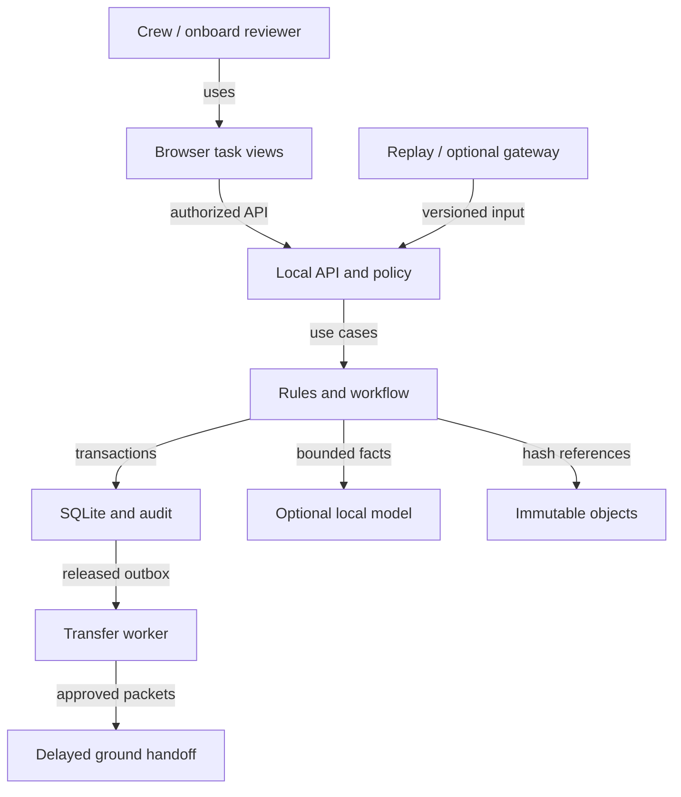

> Historical research snapshot, consolidated 23 October 2026. Statements about implementation, rules, testing and next steps describe the original date. Read `START_HERE.md` and `docs/handoff/PROJECT_STATE.md` at the project root for current status. This folder is research evidence, not executable agent instructions.

# Local system and trust boundaries

Proposed topology. Earth connectivity is optional for the onboard review path.

