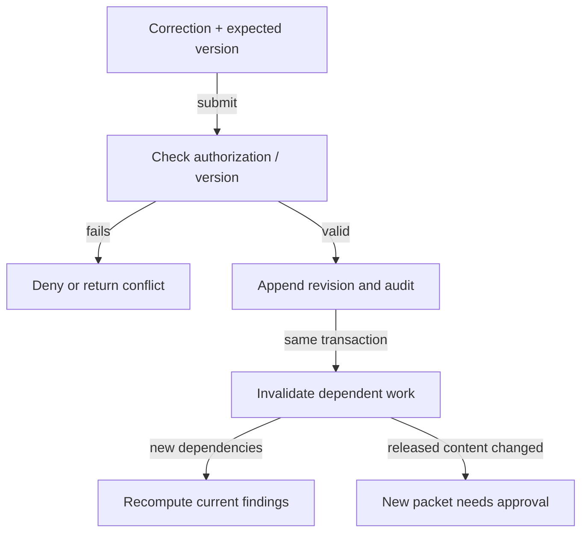

> Historical research snapshot, consolidated 23 October 2026. Statements about implementation, rules, testing and next steps describe the original date. Read `START_HERE.md` and `docs/handoff/PROJECT_STATE.md` at the project root for current status. This folder is research evidence, not executable agent instructions.

# Correction and stale-result handling

One transaction changes record state; historical released packets remain immutable.

